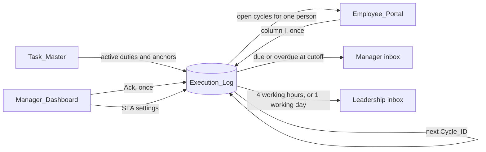

# Allo Innoware Recurring Task & Escalation Engine

Google Sheets and Apps Script system for recurring operations work: cycle creation, one-place completion, same-day manager alerts, and leadership escalation on a working-hours clock.

The spreadsheet timezone is **Asia/Kolkata**. The log is the system of record. Employees finish a cycle in one cell. Managers review it with one checkbox.

## Executive summary

Operations runs four recurring duties: a daily update on each working day, and portal tasks every 7, 15, and 30 days. Each duty has a first due date. From that date the engine opens a cycle, shows the employee what is due, and records proof, person, and time when the cycle is closed. Closing a cycle creates the next one. A daily cycle lands on the next working day. A 7-, 15-, or 30-day cycle lands on the next calendar interval, including weekends.

If the cycle is still open at the due-time cutoff, the manager receives one email that names the employee, the task, and the cycle. The manager ticks **Ack**. That tick is the review. Leadership is notified once, either when four working hours pass with no acknowledgement, or when the task is still unfinished one working day after the due date. A second run of the same job does not insert a second cycle, completion, acknowledgement, or email.

| Document | What it decides |
| --- | --- |
| [docs/SHEET_SCHEMA.md](docs/SHEET_SCHEMA.md) | Tabs, columns, formulas, validations, and SLA rules |
| [docs/TEST_RUNBOOK.md](docs/TEST_RUNBOOK.md) | The eight demonstration cases, with seed data and expected states |

## Architecture

`Task_Master` holds the duty. `Execution_Log` holds one row per cycle. `Employee_Portal` is the only place a cycle is completed. `Manager_Dashboard` holds SLA settings and the cross-team queue. Apps Script reads and writes the log. Portal and queue columns other than the proof cell and the Ack checkbox are formulas.



The bound script is split along that flow:

| Module | Responsibility |
| --- | --- |
| `Config.js` | Sheet names, columns, and named-range settings with seed defaults |
| `TaskEngine.js` | Daily, 7-, 15-, and 30-day cycles. Idempotent insert. Successor on completion |
| `EmployeeService.js` | Portal rows for one employee. Proof check. One-time close |
| `EscalationEngine.js` | Working-hour clock, manager mail, leadership mail, Ack stamp, queue keys |
| `UIHandler.js` | Menu, edit routing, and the 30-minute poll |

A script lock wraps cycle creation, completion, queue refresh, and both emails. Menu actions toast a result and return.

## Repository layout

```text
.
├── README.md
├── docs
│   ├── SHEET_SCHEMA.md      # workbook contract
│   └── TEST_RUNBOOK.md      # tests 1–8
└── src
    ├── Config.js
    ├── TaskEngine.js
    ├── EmployeeService.js
    ├── EscalationEngine.js
    └── UIHandler.js
```

There is no `appsscript.json` in this repository. The supported install is a spreadsheet-bound Apps Script project, described below.

## Design highlights

### Idempotency

`Cycle_ID` is `{Task_ID}-{yyyy-MM-dd}` of the due date, for example `T-002-2026-11-09`. The cycle job may run on every poll. A second insert of the same id is skipped. A second completion leaves the log unchanged and shows `Locked` on the portal. Manager mail, leadership mail, and `Manager_Ack` are written only after the action succeeds, and only when the stamp cell is blank. Mail goes out first. A failed send leaves the cell blank so the next poll can retry.

### Working-hours SLA

The manager email fires at `Due_By_Time` on the due date (default 18:00), while the task is still Due Today or Overdue. Acknowledgement time counts only from 09:00 to 18:00, Monday to Friday, in Asia/Kolkata. An alert at 18:00 Friday matures at 13:00 Monday. An alert at 15:00 Wednesday matures at 10:00 Thursday. The task itself remains open until the same cutoff one working day later: Monday’s due date resolves Tuesday at 18:00, and Friday’s resolves the following Monday. If both clocks are due in the same poll, the single leadership reason is `MGR_ACK_MISSED`.

### Single-point portal

The employee sees task, window, status, proof type, and instructions on `Employee_Portal`, and types only in column I. The script copies that value to the log, stamps the signed-in account and the time, and opens the next cycle. `Task_Master` and `Execution_Log` are not part of the employee’s update. Set `Employee_Portal!Z1` (`PORTAL_VIEW_AS`) to an employee email when one editor needs to demonstrate Employee A through D. A blank Z1 uses the signed-in account.

### WhatsApp `Posted` token

The daily operations update has no ticket. The employee posts in the Ops WhatsApp group, then selects **Posted** from the column I dropdown. `Posted` is `CFG_DAILY_TOKEN`. The dropdown is the whole sheet action. The script stores who selected it and when. Ticket work uses a portal ticket id that matches `CFG_TICKET_REGEX`. A valid example is `TCK-1042`.

## Deploy to Google Sheets

### 1. Create the workbook

1. Create a Google Sheet.
2. **File → Settings → Time zone → (GMT+05:30) India Standard Time — Asia/Kolkata**.
3. Build the four tabs, headers, named ranges, formulas, dropdowns, checkboxes, and conditional formats in the order in [docs/SHEET_SCHEMA.md](docs/SHEET_SCHEMA.md) section 11.
4. Confirm `Task_Master` column F shows 1, 7, 15, and 30, and that `Execution_Log` column E is the status formula. The script never writes column E.
5. Paste the settings seed on `Manager_Dashboard` row 2 and the four task rows in section 5.4 of the schema. Replace `manager@example.com` and the leadership addresses with inboxes you can open before you rely on mail.

### 2. Add the script

1. **Extensions → Apps Script**.
2. Name the project `Allo Ops Automation`.
3. Remove the empty `Code.gs` file, or replace its contents with the first file below. Do not leave a second copy of the same functions.
4. For each file in `src/`, add a script file and paste the full contents. Apps Script stores them as `.gs`. Keep the function names as they are in the source. `onOpen`, `onEdit`, and the menu handlers must stay global.

| Repository file | Suggested script file |
| --- | --- |
| `src/Config.js` | `Config.gs` |
| `src/TaskEngine.js` | `TaskEngine.gs` |
| `src/EmployeeService.js` | `EmployeeService.gs` |
| `src/EscalationEngine.js` | `EscalationEngine.gs` |
| `src/UIHandler.js` | `UIHandler.gs` |

5. **Project Settings → Time zone → Asia/Kolkata**. Leave the runtime on V8.
6. Save the project.

### 3. Authorize and install the poll

1. Reload the spreadsheet. The menu **🚀 Allo Ops Automation** appears on open.
2. Run **Install 30-Min Trigger** and accept the permission prompt. This authorizes the spreadsheet, Gmail send, and triggers. It creates one clock trigger on `runScheduledPoll` at `CFG_POLL_MINUTES` (30 by default) and one installable `onEdit` so portal proof and Ack ticks can take the script lock. Running the menu item again replaces those triggers.
3. Menu → **Run Cycle Job**. On Monday 2026-11-02, before 18:00, the log should contain:

| Cycle_ID | Cycle_Start | Due_Date | Status |
| --- | --- | --- | --- |
| `T-001-2026-11-02` | 2026-11-02 | 2026-11-02 | Due Today |
| `T-002-2026-11-02` | 2026-10-27 | 2026-11-02 | Due Today |
| `T-003-2026-11-16` | 2026-11-02 | 2026-11-16 | Pending |
| `T-004-2026-12-01` | 2026-11-02 | 2026-12-01 | Pending |

4. Set `Employee_Portal!Z1` to the employee you are demonstrating and run **Refresh Portal**. Complete a cycle only in column I. Tick **Ack** only on `Manager_Dashboard`.
5. Walk [docs/TEST_RUNBOOK.md](docs/TEST_RUNBOOK.md) for the eight required cases.

### Menu

| Item | Effect |
| --- | --- |
| Run Cycle Job | Insert any cycle whose window has started, and one future successor when the latest cycle is already complete |
| Refresh Portal | Rebuild column A for `PORTAL_VIEW_AS`, or for the signed-in user |
| Refresh Manager Queue | Stamp any pending Ack tick, then rewrite cycle ids without moving a checkbox onto another cycle |
| Run Escalation Poll | Cycle job, manager mail, leadership mail, and a queue refresh |
| Install 30-Min Trigger | One clock trigger and one authorized edit trigger |

A second click of the same menu item within 30 seconds is ignored. The services under the menu still refuse a duplicate cycle, completion, acknowledgement, or email after that window.

### Operate

Share the sheet with Editor access for anyone who must run the menu or edit column I and Ack. Viewers can read the queue. They cannot complete a cycle or install the trigger.

The log is append-only for cycle identity. Do not delete a cycle to reset a demonstration. Duplicate the file before the first cycle job if you need the Monday baseline again.
