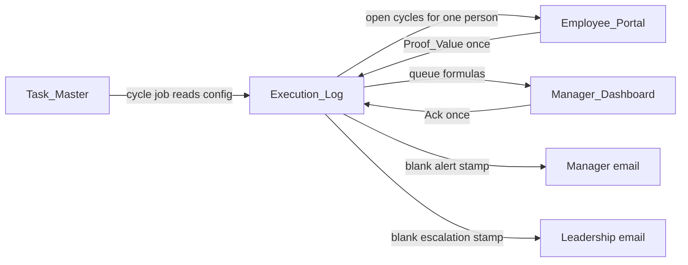

# Google Sheets blueprint

Workbook for Allo Innoware recurring-task tracking: pending work, one-time completion, same-day manager alert, and leadership escalation.

The spreadsheet timezone is **Asia/Kolkata**. `TODAY()` and `NOW()` must use that clock. Formulas below use the comma argument separator (English locale).

Four tabs, in this order:

| Tab | Role | Who types |
| --- | --- | --- |
| `Task_Master` | Task configuration and first due date | Admin |
| `Execution_Log` | One row per cycle. System of record | Apps Script only |
| `Employee_Portal` | The only place a cycle is completed | Employee, column I only |
| `Manager_Dashboard` | SLA settings, cross-team queue, acknowledgement | Admin (settings), manager (Ack checkbox) |

Completion is entered once, in `Employee_Portal` column I. The script copies that value into `Execution_Log` and closes the cycle. The manager's only operational action is the `Ack` checkbox.



## 1. Conventions

### 1.1 Identifiers

- `Task_ID`: `T-` plus three or more digits. Example: `T-002`.
- `Cycle_ID`: `{Task_ID}-{Due_Date}` with the due date as `yyyy-MM-dd`. Example: `T-002-2026-11-09`.
- `Cycle_ID` is the idempotency key. A second row with the same id is never inserted. A second completion, manager email, acknowledgement, or leadership email is never written for that id.

`Cycle_Anchor` on `Task_Master` is the **first due date**, not the first day the window opens.

### 1.2 Types and display formats

| Type | Format | Notes |
| --- | --- | --- |
| Text | Plain text | IDs, names, instructions |
| Email | Plain text | Must pass `ISEMAIL` |
| Date | `yyyy-mm-dd` | No time component |
| Time | `hh:mm` | Due cutoff |
| DateTime | `yyyy-mm-dd hh:mm:ss` | True date values, spreadsheet timezone |
| Number | `0` | Integers |
| Boolean | Checkbox | Unchecked `FALSE`, checked `TRUE` |
| Enum | Dropdown | Reject invalid values |
| Audit stamp | Plain text | See below |

Audit stamp columns are Plain text so Sheets does not coerce them into dates.

- Manager acknowledgement: `yyyy-MM-dd HH:mm:ss | email`
- Leadership escalation: `yyyy-MM-dd HH:mm:ss | MGR_ACK_MISSED` or `yyyy-MM-dd HH:mm:ss | UNRESOLVED_SLA`

The separator is space-pipe-space. Parse with `TRIM(INDEX(SPLIT(cell,"|"),1,2))`.

### 1.3 Header, freeze, filter

On `Task_Master` and `Execution_Log`, row 1 is the header, frozen, with a filter on.

On `Employee_Portal`, row 1 is the header, frozen, with a filter on. Columns A–K are the data contract. An operator control sits in `Y1:Z1` (section 6.1).

On `Manager_Dashboard`, row 1 is the settings header and row 5 is the queue header. Freeze rows 1–5.

Pre-create 200 data rows on each table so fill-down formulas and checkboxes already exist.

### 1.4 Protection

Submitted prototype: protect the ranges below with **“Show a warning when editing”** so a reviewer with Editor access can still test.

Production: same ranges, editors limited to the script owner and an admin account.

| Range | Editable by |
| --- | --- |
| `Task_Master!A2:E`, `G2:K` | Admin |
| `Task_Master!F2:F` | Nobody. Array formula |
| `Execution_Log!A2:D`, `F2:K` | Script |
| `Execution_Log!E2:E` | Nobody. Array formula |
| `Employee_Portal!A2:H`, `J2:K` | Script. Column I is the employee |
| `Employee_Portal!I2:I` | Employee |
| `Employee_Portal!Z1` | Demo operator |
| `Manager_Dashboard!A2:K2` | Admin |
| `Manager_Dashboard!A6:I`, `K6:K` | Nobody. Formulas |
| `Manager_Dashboard!J6:J` | Manager |

### 1.5 Named ranges

| Name | Refers to |
| --- | --- |
| `CFG_MANAGER_EMAIL` | `Manager_Dashboard!A2` |
| `CFG_LEADERSHIP_EMAILS` | `Manager_Dashboard!B2` |
| `CFG_TIMEZONE` | `Manager_Dashboard!C2` |
| `CFG_ACK_SLA_HOURS` | `Manager_Dashboard!D2` |
| `CFG_RESOLVE_WORKING_DAYS` | `Manager_Dashboard!E2` |
| `CFG_POLL_MINUTES` | `Manager_Dashboard!F2` |
| `CFG_WEEKDAYS` | `Manager_Dashboard!G2` |
| `CFG_DEFAULT_DUE_TIME` | `Manager_Dashboard!H2` |
| `CFG_GO_LIVE` | `Manager_Dashboard!I2` |
| `CFG_DAILY_TOKEN` | `Manager_Dashboard!J2` |
| `CFG_TICKET_REGEX` | `Manager_Dashboard!K2` |
| `PORTAL_VIEW_AS` | `Employee_Portal!Z1` |

## 2. Recurrence

Non-daily frequencies are calendar-day periods of 7, 15, or 30 days from `Cycle_Anchor`. They are not “same weekday” and they are not end-of-month. A 15-day or 30-day due date may fall on a weekend. A 7-day task anchored on a Monday stays on Mondays.

Daily tasks exist only on the weekdays listed in `CFG_WEEKDAYS` (`Mon`–`Fri`). Saturday and Sunday never get a daily row.

For cycle index `n` starting at 0:

```text
Frequency_Days = 1, 7, 15, or 30

due(n)   = Cycle_Anchor + n * Frequency_Days
start(n) = due(n) - Frequency_Days + 1
```

Daily special case: `due(n) = start(n) =` the nth weekday on or after `Cycle_Anchor`. The successor of a Friday daily cycle is Monday.

Adjacent non-daily cycles do not overlap and do not leave a gap:

```text
start(n+1) = due(n) + 1
due(n+1)   = due(n) + Frequency_Days
```

### 2.1 Which cycles exist

The cycle job is idempotent. It may run on every poll.

For each row with `Active = Yes`:

1. Materialize every cycle whose `start <= today`, whose `due >= Go_Live_Date`, and whose date is legal for that frequency. Daily dates must be weekdays.
2. If the latest cycle already in the log for that task has `Completed_At` filled, materialize exactly one successor, even when that successor’s start is still in the future.

Skip step 2 when `Active = No`. In-flight rows already in the log stay there.

On the first install this does not invent cycles due before `Go_Live_Date`.

`n` for a non-daily task is:

```text
if today < start(0): create nothing for "today"
else n = max(0, floor((today - Cycle_Anchor) / Frequency_Days))
```

`floor` of a negative number must be clamped to 0. Before the anchor date the open cycle is still `n = 0` once `start(0)` has been reached.

### 2.2 Status

Stored dates do not change after the row is created. Later edits to `Frequency` affect new cycles only.

`Execution_Log!E2` (result type Text). This array owns the whole column:

```gs
=ARRAYFORMULA(IF(A2:A="","",
  IF(H2:H<>"","Completed",
    IF(C2:C="","",
      IF(C2:C>TODAY(),"Scheduled",
        IF(D2:D<TODAY(),"Overdue",
          IF(D2:D=TODAY(),"Due Today","Pending")))))))
```

| Status | Meaning | Employee portal | Manager queue |
| --- | --- | --- | --- |
| `Pending` | Window is open and the due date is still ahead | Shown | Shown |
| `Due Today` | Due date is today and it is not completed | Shown | Shown |
| `Overdue` | Due date is past and it is not completed | Shown | Shown |
| `Scheduled` | Next cycle already created, start date is still ahead | Hidden | Hidden |
| `Completed` | `Completed_At` is set | Hidden after refresh | Kept 7 days if a manager alert was sent |

`Completed` wins over the date tests, so a late completion does not stay `Overdue`.

### 2.3 Closing a cycle

When portal `Entry_Check` becomes `Valid` and the log row’s `Completed_At` is blank, in one script lock:

1. Copy portal `Proof_Value` to log `Proof_Value`.
2. Set `Completed_By` to the editor’s Google account. If that address is empty, use the employee email on `Task_Master`.
3. Set `Completed_At` to now.
4. Run the cycle job so the successor exists.
5. Set portal `Sync_Status` to `Synced`.

If `Completed_At` is already set, leave the log row unchanged and set `Sync_Status` to `Locked`.

## 3. Daily completion

Daily work does not produce a ticket. The employee:

1. Posts the operations update in the Ops WhatsApp group.
2. Opens `Employee_Portal` and chooses `Posted` on that task’s row.

`Posted` is the value of `CFG_DAILY_TOKEN`. The dropdown is the whole sheet action. The employee does not type a time, a name, or a second copy of the task. The script stores the account and the timestamp.

Seed instruction for the daily task (column K):

```text
Post today's operations update in the Ops WhatsApp group. Then choose Posted in Proof_Value on this row.
```

## 4. Alerts and SLA

Poll every `CFG_POLL_MINUTES` (30) all week, under a script lock. A weekend run creates no daily cycle and sends no mail, because no daily due date and no working-hour clock falls on Saturday or Sunday.

Default cutoff is 18:00. Each task may override it with `Due_By_Time`.

### 4.1 Manager email — same day

Send one email to `CFG_MANAGER_EMAIL` when all of these are true:

- The task is `Active`.
- Status is `Due Today` or `Overdue`.
- `Manager_Alert_Sent_At` is blank.
- Now is at or after `Due_Date` + `Due_By_Time` in Asia/Kolkata.

The overdue clause is the catch-up: if the 18:00 poll did not run, the next poll sends that same alert once. It does not send a second one on later days.

Subject:

```text
[Allo Ops] Pending: {Assigned_To} — {Task_Name} ({Cycle_ID})
```

Body includes employee name, employee email, task name, cycle id, cycle start, due date, proof type, status, and the due cutoff. After `MailApp` succeeds, write `Manager_Alert_Sent_At`. If sending fails, leave the cell blank so the next poll can retry.

### 4.2 What the manager does

Open `Manager_Dashboard`, read the row, tick `Ack`. That tick is the review. The manager does not re-enter the ticket. The script writes `Manager_Ack` once. Clearing the checkbox does not clear the stamp; the refresh puts the check back.

### 4.3 Working hours

Ack SLA uses working time only.

- Window: 09:00–18:00 Asia/Kolkata.
- Days: `Mon,Tue,Wed,Thu,Fri`.
- Hours outside that window, and all weekend hours, add zero.

Elapsed working time from an alert timestamp walks that window until `CFG_ACK_SLA_HOURS` (4) hours are consumed. An alert at 18:00 Friday matures at 13:00 Monday. An alert at 15:00 Wednesday matures at 10:00 Thursday (three hours left on Wednesday, one hour on Thursday).

### 4.4 Leadership email

Send one email to every address in `CFG_LEADERSHIP_EMAILS` when `Leadership_Escalation` is blank and either trigger below is true. If both are true in the same run, the reason is `MGR_ACK_MISSED`.

| Order | Code | When |
| --- | --- | --- |
| 1 | `MGR_ACK_MISSED` | `Manager_Alert_Sent_At` is set, `Manager_Ack` is blank, and 4 working hours have elapsed |
| 2 | `UNRESOLVED_SLA` | `Completed_At` is blank and now is at or after the resolution deadline |

Resolution deadline = `Due_By_Time` on the date `CFG_RESOLVE_WORKING_DAYS` (1) working days after `Due_Date`. A Monday 18:00 due date resolves by Tuesday 18:00. A Friday due date resolves by Monday at `Due_By_Time`.

Subject:

```text
[Allo Ops] Escalation {reason_code}: {Assigned_To} — {Task_Name} ({Cycle_ID})
```

Body includes the manager alert time, whether an ack stamp exists, proof, completion time, and which rule fired. Write `Leadership_Escalation` only after a successful send. A later trigger does not send again.

### 4.5 Why this timing

The same-day manager email fires at the task cutoff, so the employee has the whole day and the manager hears about it on the due date. Ack SLA is 4 working hours, not “end of the same calendar day”: a cutoff at 18:00 leaves no working time that evening, and leadership should hear the next morning if the manager has not reviewed. The employee still has until the next working day’s cutoff to finish the task before a non-completion escalation. Those are separate facts: a missed review escalates even when the resolution window is open, and a reviewed but still-open task escalates when the window ends. Each event has one timestamp, so reruns do not send a second email.

## 5. `Task_Master`

Header row 1. Data from row 2. One row per recurring task. An employee may own more than one task. `Task_ID` is unique.

| Col | Name | Type | Writer | Rule |
| --- | --- | --- | --- | --- |
| A | `Task_ID` | Text | Admin | Matches `^T-\d{3,}$`. Unique |
| B | `Task_Name` | Text | Admin | Required when active |
| C | `Assigned_To` | Enum | Admin | Dropdown |
| D | `Employee_Email` | Email | Admin | `ISEMAIL`. Portal matches this address |
| E | `Frequency` | Enum | Admin | Dropdown |
| F | `Frequency_Days` | Number formula | Formula | 1, 7, 15, or 30 |
| G | `Proof_Type` | Enum | Admin | Tied to frequency |
| H | `Cycle_Anchor` | Date | Admin | First due date. Daily anchor must be a weekday |
| I | `Active` | Enum | Admin | `Yes` or `No` |
| J | `Due_By_Time` | Time | Admin | Same-day alert cutoff. Blank uses `CFG_DEFAULT_DUE_TIME` |
| K | `Work_Instruction` | Text | Admin | Shown on the employee row |

`F2`:

```gs
=ARRAYFORMULA(IF(E2:E="","",
  IFS(
    E2:E="Daily",1,
    E2:E="Every 7 days",7,
    E2:E="Every 15 days",15,
    E2:E="Every 30 days",30,
    TRUE,""
  )))
```

### 5.1 Dropdowns

| Cell | List | Reject other input |
| --- | --- | --- |
| `C2:C` | `Employee A`, `Employee B`, `Employee C`, `Employee D` | Yes |
| `E2:E` | `Daily`, `Every 7 days`, `Every 15 days`, `Every 30 days` | Yes |
| `G2:G` | `Ticket ID`, `Daily Confirmation` | Yes |
| `I2:I` | `Yes`, `No` | Yes |

Extend the `Assigned_To` list when a real name is added. Keep the displayed name and `Employee_Email` on the same row.

### 5.2 Other validation

Applied from row 2 down. Show a warning and reject invalid input.

| Range | Rule |
| --- | --- |
| `A2:A` | Custom: `=REGEXMATCH(A2,"^T-\d{3,}$")` |
| `A2:A` unique | Custom: `=COUNTIF($A$2:$A,A2)=1` |
| `B2:B` | Text is not empty |
| `D2:D` | Custom: `=ISEMAIL(D2)` |
| `G2:G` | Custom: `=OR(AND(E2="Daily",G2="Daily Confirmation"),AND(E2<>"Daily",E2<>"",G2="Ticket ID"))` |
| `H2:H` | Date, is valid date |
| `H2:H` weekday when daily | Custom: `=AND(ISDATE(H2),OR(E2<>"Daily",WEEKDAY(H2,2)<=5))` |
| `J2:J` | Time, is valid time |

`WEEKDAY(...,2)` numbers Monday as 1 and Sunday as 7.

### 5.3 Conditional formatting

Range `A2:K500` unless a row names a narrower range. Rule 1 wins over later rules when they set the same property.

| Order | Applies to | Formula | Format |
| --- | --- | --- | --- |
| 1 | `A2:A` | `=AND($A2<>"",COUNTIF($A$2:$A,$A2)>1)` | Fill `#CC0000`, font `#FFFFFF` |
| 2 | `A2:K500` | `=$I2="No"` | Font `#999999` |
| 3 | `G2:G` | `=AND($E2<>"",$G2<>"",OR(AND($E2="Daily",$G2<>"Daily Confirmation"),AND($E2<>"Daily",$G2<>"Ticket ID")))` | Fill `#F4C7C3` |
| 4 | `H2:H` | `=AND($E2="Daily",ISDATE($H2),WEEKDAY($H2,2)>5)` | Fill `#F4C7C3` |
| 5 | `A2:K500` | `=AND($I2="Yes",$A2<>"",A2="",OR(COLUMN(A2)=1,COLUMN(A2)=2,COLUMN(A2)=3,COLUMN(A2)=4,COLUMN(A2)=5,COLUMN(A2)=7,COLUMN(A2)=8,COLUMN(A2)=10,COLUMN(A2)=11))` | Fill `#FCE8B2` |

Rule 5 highlights an empty required cell on an active row. Column F (formula) and column I (the flag itself) are excluded.

### 5.4 Seed rows

`Due_By_Time` is `18:00`. `Active` is `Yes`. Emails are placeholders to replace before the sheet is shared.

| Task_ID | Task_Name | Assigned_To | Employee_Email | Frequency | Proof_Type | Cycle_Anchor | Work_Instruction |
| --- | --- | --- | --- | --- | --- | --- | --- |
| `T-001` | Daily Operations Update | Employee A | `employee.a@example.com` | Daily | Daily Confirmation | `2026-11-02` | Post today's operations update in the Ops WhatsApp group. Then choose Posted in Proof_Value on this row. |
| `T-002` | Portal Task A | Employee B | `employee.b@example.com` | Every 7 days | Ticket ID | `2026-11-02` | Complete Portal Task A in the portal and enter that Ticket ID in Proof_Value on this row. |
| `T-003` | Portal Task B | Employee C | `employee.c@example.com` | Every 15 days | Ticket ID | `2026-11-16` | Complete Portal Task B in the portal and enter that Ticket ID in Proof_Value on this row. |
| `T-004` | Portal Task C | Employee D | `employee.d@example.com` | Every 30 days | Ticket ID | `2026-12-01` | Complete Portal Task C in the portal and enter that Ticket ID in Proof_Value on this row. |

`Frequency_Days` calculates as 1, 7, 15, 30.

On Monday 2026-11-02 the cycle job should produce:

| Cycle_ID | Cycle_Start | Due_Date | Status |
| --- | --- | --- | --- |
| `T-001-2026-11-02` | 2026-11-02 | 2026-11-02 | Due Today |
| `T-002-2026-11-02` | 2026-10-27 | 2026-11-02 | Due Today |
| `T-003-2026-11-16` | 2026-11-02 | 2026-11-16 | Pending |
| `T-004-2026-12-01` | 2026-11-02 | 2026-12-01 | Pending |

Completing `T-002` on 2026-11-02 adds `T-002-2026-11-09` with start `2026-11-03`, due `2026-11-09`, status `Scheduled`. The portal hides that scheduled row.

To force a same-day alert on the day of a demo, set that task’s `Cycle_Anchor` to the demo date and set `Due_By_Time` a few minutes ahead, then run the poll. Daily anchors must be weekdays.

## 6. `Execution_Log`

Header row 1. Data from row 2. Append a row only when its `Cycle_ID` is absent. Never delete a cycle to “reset” a demo; complete it or leave it.

| Col | Name | Type | Writer | Rule |
| --- | --- | --- | --- | --- |
| A | `Cycle_ID` | Text | Script | `{Task_ID}-{yyyy-MM-dd of Due_Date}`. Unique |
| B | `Task_ID` | Text | Script | Must exist on `Task_Master` |
| C | `Cycle_Start` | Date | Script | Frozen at creation |
| D | `Due_Date` | Date | Script | Frozen at creation |
| E | `Status` | Text formula | Formula | Section 2.2 |
| F | `Proof_Value` | Text | Script | Ticket id, or `Posted`. Written once |
| G | `Completed_By` | Email | Script | Account that submitted column I |
| H | `Completed_At` | DateTime | Script | Blank until the cycle closes |
| I | `Manager_Alert_Sent_At` | DateTime | Script | Blank until the one manager email sends |
| J | `Manager_Ack` | Audit stamp | Script | Plain text. Blank until Ack is ticked |
| K | `Leadership_Escalation` | Audit stamp | Script | Plain text. Blank until the one leadership email sends |

Columns J and K are Plain text. Columns C, D, H, and I use the date formats in section 1.2.

### 6.1 Validation

| Range | Rule |
| --- | --- |
| `A2:A` | Custom: `=COUNTIF($A$2:$A,A2)<=1` |
| `B2:B` | Custom: `=COUNTIF(Task_Master!$A$2:$A,B2)=1` |

The script’s lookup is authoritative. Validation stops a hand-typed duplicate during a review.

### 6.2 Conditional formatting

Range `A2:K500` unless noted. Rule 1 wins over later rules when they set the same property.

| Order | Range | Formula | Format |
| --- | --- | --- | --- |
| 1 | `A2:K500` | `=AND($A2<>"",COUNTIF($A$2:$A,$A2)>1)` | Fill `#CC0000`, font `#FFFFFF` |
| 2 | `A2:K500` | `=$K2<>""` | Fill `#F4C7C3`. Column K font `#990000` bold |
| 3 | `A2:K500` | `=$E2="Completed"` | Fill `#D9EAD3` |
| 4 | `A2:K500` | `=$E2="Overdue"` | Fill `#F4C7C3` |
| 5 | `A2:K500` | `=$E2="Due Today"` | Fill `#FCE8B2` |
| 6 | `A2:K500` | `=$E2="Scheduled"` | Fill `#F3F3F3`, font `#666666` |
| 7 | `A2:K500` | `=$E2="Pending"` | Fill `#D2E3FC` |
| 8 | `I2:I500` | `=AND($I2<>"",$J2="",$H2="")` | Fill `#F6B26B` |

Rule 8 marks a manager alert that still has no acknowledgement and no completion. It colors column I only.

## 7. `Employee_Portal`

The employee works here and nowhere else. Row 1 headers:

| Col | Name | Type | Writer | Rule |
| --- | --- | --- | --- | --- |
| A | `Cycle_ID` | Text | Script | Key. One open cycle per row |
| B | `Task_Name` | Text formula | Formula | From `Task_Master` |
| C | `Due_Date` | Date formula | Formula | From the log |
| D | `Cycle_Window` | Text formula | Formula | `start → due` |
| E | `Status` | Text formula | Formula | From the log |
| F | `Proof_Required` | Text formula | Formula | `Proof_Type` |
| G | `Work_Instruction` | Text formula | Formula | From `Task_Master` |
| H | `Assigned_To` | Text formula | Formula | From `Task_Master` |
| I | `Proof_Value` | Text or enum | Employee | The only completion input |
| J | `Entry_Check` | Text formula | Formula | `Missing`, `Valid`, or an error |
| K | `Sync_Status` | Text | Script | Blank, `Synced`, `Locked`, or `Error: …` |

Fill formulas from row 2 through row 201. Column I has no formula. Column K is written by the script.

`B2` (fill down):

```gs
=IF($A2="","",IFERROR(VLOOKUP(VLOOKUP($A2,Execution_Log!$A:$B,2,FALSE),Task_Master!$A:$B,2,FALSE),""))
```

`C2`:

```gs
=IF($A2="","",IFERROR(VLOOKUP($A2,Execution_Log!$A:$D,4,FALSE),""))
```

`D2`:

```gs
=IF($A2="","",IFERROR(TEXT(VLOOKUP($A2,Execution_Log!$A:$C,3,FALSE),"YYYY-MM-DD")&" → "&TEXT(C2,"YYYY-MM-DD"),""))
```

`E2`:

```gs
=IF($A2="","",IFERROR(VLOOKUP($A2,Execution_Log!$A:$E,5,FALSE),""))
```

`F2`:

```gs
=IF($A2="","",IFERROR(VLOOKUP(VLOOKUP($A2,Execution_Log!$A:$B,2,FALSE),Task_Master!$A:$G,7,FALSE),""))
```

`G2`:

```gs
=IF($A2="","",IFERROR(VLOOKUP(VLOOKUP($A2,Execution_Log!$A:$B,2,FALSE),Task_Master!$A:$K,11,FALSE),""))
```

`H2`:

```gs
=IF($A2="","",IFERROR(VLOOKUP(VLOOKUP($A2,Execution_Log!$A:$B,2,FALSE),Task_Master!$A:$C,3,FALSE),""))
```

`J2`:

```gs
=IF($A2="","",
  IF($I2="","Missing",
    IF(F2="Daily Confirmation",
      IF($I2=CFG_DAILY_TOKEN,"Valid","Select "&CFG_DAILY_TOKEN),
      IF(REGEXMATCH(TO_TEXT($I2),CFG_TICKET_REGEX),"Valid","Invalid Ticket ID"))))
```

Formats: column C as `yyyy-mm-dd`. Columns B, D, E, F, G, H, J, K as Plain text.

### 7.1 Who the rows belong to

`Y1` is the label `View_As_Email`. `Z1` (`PORTAL_VIEW_AS`) is a dropdown of `Task_Master!D2:D`, blank allowed, plus a blank item.

- Blank `Z1`: the script uses the signed-in Google account.
- A selected email: demo override so one editor can exercise Employee A through D.

Refresh writes column A with the cycles whose status is `Pending`, `Due Today`, or `Overdue`, and whose `Employee_Email` equals that resolved address. `Scheduled` and `Completed` rows are omitted. Refresh keeps a `Proof_Value` the employee already typed for a `Cycle_ID` that is still open. It does not append a log row by itself; the cycle job does that, once per id.

Hide columns Y–Z for a clean employee view. Unhide them for the graded demo.

### 7.2 Proof validation

Column-level validation cannot be both a dropdown and a ticket pattern. On each refresh, `applyProofValidation(row)` sets column I for that row:

| `Proof_Required` | Validation |
| --- | --- |
| `Daily Confirmation` | Dropdown, one item: the exact text in `CFG_DAILY_TOKEN` (`Posted`). Show dropdown. Reject other input |
| `Ticket ID` | Custom formula `=OR(I2="",REGEXMATCH(TO_TEXT(I2),CFG_TICKET_REGEX))`. Blank is allowed while the cell is untouched. The script commits only when `Entry_Check` is `Valid` |

Ticket pattern seeded in settings: `^[A-Za-z0-9][A-Za-z0-9_-]{2,30}$` (3 to 31 letters, digits, hyphens, or underscores). Example that passes: `TCK-1042`.

### 7.3 Conditional formatting

| Order | Range | Formula | Format |
| --- | --- | --- | --- |
| 1 | `A2:H201` | `=$E2="Overdue"` | Fill `#F4C7C3` |
| 2 | `A2:H201` | `=$E2="Due Today"` | Fill `#FCE8B2` |
| 3 | `A2:H201` | `=$E2="Pending"` | Fill `#D2E3FC` |
| 4 | `I2:I201` | `=$J2="Valid"` | Fill `#D9EAD3` |
| 5 | `I2:I201` | `=AND($J2<>"",$J2<>"Valid",$J2<>"Missing")` | Fill `#F4C7C3` |
| 6 | `I2:I201` | `=AND($J2="Missing",OR($E2="Due Today",$E2="Overdue"))` | Fill `#FCE8B2` |
| 7 | `K2:K201` | `=$K2="Synced"` | Fill `#D9EAD3` |
| 8 | `K2:K201` | `=$K2="Locked"` | Fill `#F3F3F3` |
| 9 | `K2:K201` | `=LEFT($K2,5)="Error"` | Fill `#F4C7C3` |

Column I stays white until the check formula colors it, so the input cell is obvious.

## 8. `Manager_Dashboard`

Two regions share columns A–K.

### 8.1 Settings — rows 1 and 2

Row 1 is the field name. Row 2 is the value. Row 3 is empty. `A4` contains the label `ACTION_QUEUE`. `B4:K4` stay empty.

| Col | Row 1 name | Row 2 type | Seed | Validation |
| --- | --- | --- | --- | --- |
| A | `Manager_Email` | Email | `manager@example.com` | `=ISEMAIL(A2)` |
| B | `Leadership_Emails` | Text | `leadership.one@example.com, leadership.two@example.com` | Custom: `=REGEXMATCH(B2,"^[^@\s,]+@[^@\s,]+\.[^@\s,]+(\s*,\s*[^@\s,]+@[^@\s,]+\.[^@\s,]+)*$")` |
| C | `Timezone` | Enum | `Asia/Kolkata` | Dropdown, that single value |
| D | `Manager_Ack_SLA_Hours` | Number | `4` | Number, between 1 and 8, integer |
| E | `Resolve_Working_Days` | Number | `1` | Number, between 1 and 5, integer |
| F | `Alert_Poll_Minutes` | Enum | `30` | Dropdown `15`, `30`, `60` |
| G | `Working_Weekdays` | Enum | `Mon,Tue,Wed,Thu,Fri` | Dropdown, that single value |
| H | `Default_Due_By_Time` | Time | `18:00` | Valid time |
| I | `Go_Live_Date` | Date | `2026-10-27` | Valid date |
| J | `Daily_Proof_Token` | Text | `Posted` | Text length at least 2 |
| K | `Ticket_ID_Pattern` | Text | `^[A-Za-z0-9][A-Za-z0-9_-]{2,30}$` | Custom: `=AND(LEFT(K2,1)="^",RIGHT(K2,1)="$")` |

Formats: D–F as `0`, H as `hh:mm`, I as `yyyy-mm-dd`.

Settings conditional formatting, range `A2:K2`:

| Formula | Format |
| --- | --- |
| `=A2=""` | Fill `#F4C7C3` |

Apply that relative formula across `A2:K2` so each empty setting cell turns red. The SLA clock and the proof checks read these cells; an empty cell is a broken install.

### 8.2 Action queue — row 5 headers, data from row 6

The script writes `Cycle_ID` values into column A. It does not use a spilling `FILTER` in column A, because a spill reorders rows and would detach `Ack` checkboxes from the wrong cycle.

Inclusion, then sort:

- Status is `Pending`, `Due Today`, or `Overdue`, or
- `Manager_Alert_Sent_At` is set and (`Completed_At` is blank or `Completed_At >= TODAY()-7`), or
- `Leadership_Escalation` is set and its date prefix is on or after `TODAY()-14`.

Sort by status rank (`Overdue`, `Due Today`, `Pending`, `Completed`), then `Due_Date` ascending, then `Assigned_To`. `Scheduled` cycles stay on the log only.

Before rewriting column A, flush any checked `Ack` whose log stamp is still blank. A refresh cannot drop a tick that has not been stamped yet. Flushing twice still writes one stamp.

| Col | Name | Type | Writer | Rule |
| --- | --- | --- | --- | --- |
| A | `Cycle_ID` | Text | Script | Stable key for the checkbox |
| B | `Assigned_To` | Text formula | Formula | Employee name |
| C | `Task_Name` | Text formula | Formula | |
| D | `Due_Date` | Date formula | Formula | |
| E | `Status` | Text formula | Formula | Live from the log |
| F | `Days_Overdue` | Number formula | Formula | `0` until the due date is past. Blank when completed |
| G | `Proof_Value` | Text formula | Formula | Ticket id or `Posted` |
| H | `Completed_At` | DateTime formula | Formula | Blank while open |
| I | `Manager_Alert_Sent_At` | DateTime formula | Formula | |
| J | `Ack` | Boolean | Manager | Checkbox. The only manager input |
| K | `Escalation_State` | Text formula | Formula | Display only. Mail is sent by the poll, not by this formula |

`B6` (fill down through row 205):

```gs
=IF($A6="","",IFERROR(VLOOKUP(VLOOKUP($A6,Execution_Log!$A:$B,2,FALSE),Task_Master!$A:$C,3,FALSE),""))
```

`C6`:

```gs
=IF($A6="","",IFERROR(VLOOKUP(VLOOKUP($A6,Execution_Log!$A:$B,2,FALSE),Task_Master!$A:$B,2,FALSE),""))
```

`D6`:

```gs
=IF($A6="","",IFERROR(VLOOKUP($A6,Execution_Log!$A:$D,4,FALSE),""))
```

`E6`:

```gs
=IF($A6="","",IFERROR(VLOOKUP($A6,Execution_Log!$A:$E,5,FALSE),""))
```

`F6`:

```gs
=IF($A6="","",IF(OR(E6="",E6="Completed",E6="Scheduled"),"",MAX(0,TODAY()-D6)))
```

`G6`:

```gs
=IF($A6="","",IFERROR(VLOOKUP($A6,Execution_Log!$A:$F,6,FALSE),""))
```

`H6`:

```gs
=IF($A6="","",IFERROR(VLOOKUP($A6,Execution_Log!$A:$H,8,FALSE),""))
```

`I6`:

```gs
=IF($A6="","",IFERROR(VLOOKUP($A6,Execution_Log!$A:$I,9,FALSE),""))
```

`K6`:

```gs
=IF($A6="","",
  LET(
    ack, IFERROR(VLOOKUP($A6,Execution_Log!$A:$J,10,FALSE),""),
    esc, IFERROR(VLOOKUP($A6,Execution_Log!$A:$K,11,FALSE),""),
    reason, IF(esc="","",TRIM(INDEX(SPLIT(esc,"|"),1,2))),
    IFS(
      esc<>"", "Escalated | "&reason,
      AND(H6<>"",I6<>""), "Resolved after alert",
      AND(ack<>"",H6=""), "Acknowledged — still open",
      AND(I6<>"",ack=""), "Awaiting manager ack",
      E6="Overdue", "Overdue — not yet alerted",
      E6="Due Today", "Due today",
      TRUE, E6
    )
  ))
```

Insert checkboxes in `J6:J205` before data arrives. On refresh, set the box to `TRUE` when that cycle’s `Manager_Ack` stamp is non-blank, otherwise `FALSE`.

Ack edit rules:

- `FALSE` → `TRUE`, stamp blank: write `Manager_Ack` as `yyyy-MM-dd HH:mm:ss | {editor email}`.
- `FALSE` → `TRUE`, stamp already present: leave the stamp.
- `TRUE` → `FALSE` while a stamp exists: set the checkbox back to `TRUE`.

Formats: D as `yyyy-mm-dd`, F as `0`, H and I as `yyyy-mm-dd hh:mm:ss`.

### 8.3 Queue conditional formatting

Range `A6:K205` unless noted. Rule 1 wins over later rules when they set the same property.

| Order | Range | Formula | Format |
| --- | --- | --- | --- |
| 1 | `A6:K205` | `=LEFT($K6,9)="Escalated"` | Fill `#F4C7C3`, K font `#990000` bold |
| 2 | `A6:K205` | `=$K6="Resolved after alert"` | Fill `#D9EAD3` |
| 3 | `A6:I205` | `=$E6="Overdue"` | Fill `#F4C7C3` |
| 4 | `A6:I205` | `=$E6="Due Today"` | Fill `#FCE8B2` |
| 5 | `A6:I205` | `=$E6="Pending"` | Fill `#D2E3FC` |
| 6 | `J6:J205` | `=AND($A6<>"",$J6=FALSE,$I6<>"",$E6<>"Completed")` | Fill `#F6B26B` |
| 7 | `J6:J205` | `=AND($A6<>"",$J6=TRUE)` | Fill `#D9EAD3` |

Rule 6 is the manager’s action marker: the alert went out, the task is still open, and `Ack` is still clear.

## 9. Idempotency

One script lock wraps cycle creation, completion sync, queue refresh, and both emails.

| Event | Guard | Second run |
| --- | --- | --- |
| Create a cycle | `Cycle_ID` already in column A | No new row |
| Save completion | `Completed_At` already set | Log unchanged. Portal shows `Locked` |
| Manager email | `Manager_Alert_Sent_At` already set | No email |
| Acknowledgement | `Manager_Ack` already set | Stamp unchanged. Checkbox stays true |
| Leadership email | `Leadership_Escalation` already set | No email |
| Portal refresh | Rewrites column A from the log | Does not invent a cycle id |
| Queue refresh | Flushes a pending tick, then rewrites column A | One stamp, same checkbox binding |

Mail sends first, then the stamp. A failed send leaves the stamp blank.

## 10. Coverage

| Requirement or test | Where it is satisfied |
| --- | --- |
| Cycles reopen on their own | Section 2. Successor `Cycle_ID` is created when the current row is completed or when its start date arrives |
| Employee sees task, cycle, due date, status, proof | `Employee_Portal` columns B–G |
| One update, not two sheets | Column I is the only completion input. Script copies it to log column F |
| Ticket completion | `Proof_Type = Ticket ID`, regex on column I, stored in `Proof_Value` |
| Daily completion without a ticket | Section 3. Dropdown `Posted` |
| Who, when, and proof | Log columns F, G, H |
| Manager sees every open person in one place | Queue columns B–E, all employees, sorted overdue first |
| Manager acknowledgement | Checkbox `Ack`, stamp in `Manager_Ack` |
| Test 1 — next cycle | Completing `T-002-2026-11-02` writes `T-002-2026-11-09` |
| Test 2 — single point | Employee edits `Employee_Portal!I` only |
| Test 3 — daily method | WhatsApp post, then `Posted` |
| Test 4 — same-day email | Section 4.1, stamp in column I of the log |
| Test 5 — ack, then completion | Checkbox plus later `Completed_At`. State becomes `Acknowledged — still open` and then `Resolved after alert` |
| Test 6 — leadership | Section 4.4. Reason code is frozen in the stamp |
| Test 7 — timing | Section 4.5 |
| Test 8 — no duplicates | Section 9 |

## 11. Build order

1. Create the four tabs and set the spreadsheet timezone to `Asia/Kolkata`.
2. Enter headers and the settings seed.
3. Define the named ranges.
4. Add dropdowns, checkboxes, date formats, and the other validations.
5. Paste `Task_Master!F2`, `Execution_Log!E2`, and the fill-down formulas.
6. Paste the seed tasks.
7. Apply conditional formatting in the listed order.
8. Freeze headers, turn on filters, and apply protection warnings.
9. Confirm `Frequency_Days` shows 1, 7, 15, 30 and that both formula columns cannot be typed over.

The cycle rows, portal rows, emails, and stamps appear when the script that implements sections 2 and 4 is installed. This blueprint is the contract that script must follow.
